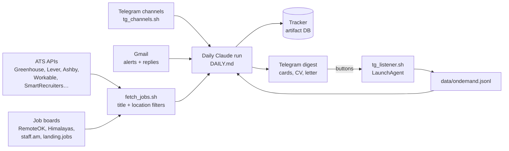

# Job Scout · Get Rich

A personal job-search system for a payments product manager, built with Claude Code in October 2026.
Every morning it collects open roles from ~120 companies and job boards, filters them by title and
location, has Claude assess them, writes tailored cover letters and salary estimates, updates a tracker
and sends a Telegram digest with one-tap buttons. The same repo holds the CVs, the case-study portfolio
and the LinkedIn visuals.

## Repository map

| Path | What it is |
|---|---|
| `cv*.html`, `*.pdf` | Base CV versions: Lead Technical PM, Solutions Architect, Billing/Platform PM, client-facing PM |
| `tailored/` | CVs, cover letters and 90-day plans tailored to specific companies |
| `portfolio/` | Case studies with architecture and sequence diagrams; `site/index.html` is published at [katedeys.github.io/katedeys-portfolio](https://katedeys.github.io/katedeys-portfolio/) |
| `linkedin/` | Post visuals and the market-data charts behind them |
| `sa_training_plan.md` | Six-week Solutions Architect training and portfolio plan |
| `tracker/` | The job tracker page (Claude artifact with a shared database) |
| `scout/` | The bot: fetchers, filters, Telegram scripts, daily instructions |
| `docs/` | Documentation (in Russian) |

## Documentation

- [Setup on a new machine](docs/setup.md)
- [Architecture and data files](docs/architecture.md)
- [The daily run, step by step](docs/daily-run.md)
- [Job sources and how to add a company](docs/sources.md)
- [Telegram bot: digest, buttons, listener](docs/telegram-bot.md)
- [Tracker: statuses and fields](docs/tracker.md)
- [CVs and cover letters](docs/cv-and-letters.md)
- [Portfolio: updating and publishing](docs/portfolio.md)
- [Git workflow](docs/git.md)

## Not in the repo

- `secrets/telegram.env` with the bot token and chat id (see `secrets/telegram.env.example`).
- `scout/data/`: fetched jobs, seen ids, logs and generated PDFs, recreated by the bot.

Keep this repository private: it contains personal CVs and job-search notes.
