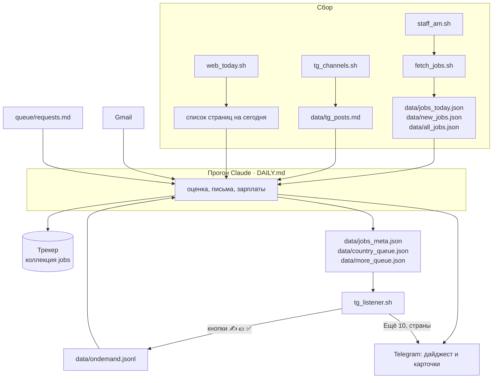

# Архитектура

Система состоит из трёх частей:

1. **Скрипты на bash** в `scout/`: собирают вакансии и отправляют сообщения в Telegram. Они работают без Claude.
2. **Ежедневный прогон Claude** по инструкции `scout/DAILY.md`. Claude оценивает вакансии, пишет письма, считает зарплаты, обновляет трекер и собирает дайджест.
3. **Фоновый слушатель Telegram** `tg_listener.sh`. Он отвечает на кнопки сразу, а тяжёлые запросы, например «напиши письмо», откладывает в очередь до прогона.

## Поток данных

## Файлы и что в них

### Настройки (в репозитории)

| Файл | Назначение |
|---|---|
| `scout/config.json` | Ссылка на трекер, версии CV (`file` и `asset_url`), пороги зарплат по форматам, страны, куда не переезжать (`no_go`), ссылки на портфолио |
| `scout/companies.tsv` | Компании и их ATS: `slug · name · region · ats · type`. Тип `P`: платёжная компания, подходит любая PM-роль. `PA`: то же, локация любая. `O`: нужен платёжный или смежный ключ в названии |
| `scout/blocklist.txt` | Компании, которые бот пропускает везде (отказ без шанса, только ЕС без релокации) |
| `scout/watchlist.tsv` | Компании, которые бот проверяет каждый час и сразу шлёт 🚨 о новой роли |
| `scout/buckets.jq` | Распределение локации по кнопкам стран (NL, UK, DE, AT, IL, AE, AM, RS, GE, ESPT, PL, EU, REMOTE, OTHER) |
| `scout/sources_web.md` | Сайты, агрегаторы и Telegram-каналы для ежедневной проверки |
| `scout/DAILY.md` | Главная инструкция ежедневного прогона |
| `scout/ONDEMAND.md` | Как обрабатывать нажатия кнопок ✍️ 💶 ✅ |
| `scout/queue/requests.md` | Разовые задачи на ближайший прогон: напоминания, фоллоу-апы, визовые дела |

### Рабочие данные (в `scout/data/`, не в репозитории)

| Файл | Что там |
|---|---|
| `all_jobs.json` | Все вакансии из всех источников за последний сбор (~12 тыс.), до фильтров |
| `jobs_today.json` | Вакансии, прошедшие фильтры по названию и локации |
| `new_jobs.json` | Из них те, которых ещё нет в `seen_ids.txt` |
| `seen_ids.txt` | ID уже оценённых вакансий |
| `consulting_today.json` | Контрактные и интерим-роли и «лиды» для консалтинга |
| `tg_posts.md` | Подходящие посты из Telegram-каналов за 2 дня |
| `jobs_meta.json` | Зарплаты и оценки для кнопки 💶 |
| `country_queue.json`, `more_queue.json` | Очереди для кнопок стран и «Ещё 10» |
| `ondemand.jsonl` | Нажатия ✍️ 💶 ✅, ждущие прогона |
| `runs.log` | Строка на каждый ежедневный прогон |
| `listener.log` | Лог слушателя Telegram |
| `out/` | Подписи карточек и PDF писем |

## Треки вакансий

`fetch_jobs.sh` присваивает каждой вакансии трек по названию:

| Трек | Когда |
|---|---|
| `SA` | Solutions Architect / Engineer / Consultant, Implementation, Integration, TAM, pre-sales, partner solutions |
| `Expansion` | Launch / expansion / market entry / international manager или head |
| `PM-payments` | PM-роль с платёжным словом (payment, billing, pricing, fraud, card, lending, wallet…) или в компании типа `P` |
| `PM-adjacent` | PM-роль со смежным словом (reconciliation, ledger, treasury, integrations, platform, KYC, risk, marketplace…) |
| `PM` | Остальные PM-роли, прошедшие фильтры |

В дайджесте два блока: продуктовый топ-10 и Solutions топ-5.

## Где что живёт кроме этого компьютера

- **Трекер:** Claude-артефакт с базой данных, коллекция `jobs`. Ссылка в `config.json → tracker_url`.
- **Портфолио:** публичная страница на GitHub Pages и черновик-артефакт. Подробности в [portfolio.md](portfolio.md).
- **Ежедневный прогон:** запланированная задача `job-scout-daily` в приложении Claude, каждый день в 9:05.
- **Слушатель Telegram:** LaunchAgent `com.katedeys.getrich`, запускается при входе в систему.
